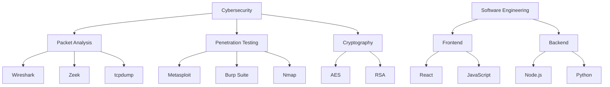

<h1>Hi 👋, I'm Your Name</h1>
<h3>Software Engineer | Cybersecurity Engineer | Network Engineer</h3>

 

### 🚀 About Me

اكتب هنا فقرة قصيرة عن نفسك (2-4 أسطر): شنو تسوي، شنو تخصصك، وشنو تحب تسوي بالمستقبل.

 

### 🛠️ Skills (خيار 1: Mermaid Diagram)

 

### 🛠️ Skills (خيار 2: جدول منظم)

| الموضوع الرئيسي | الأدوات/التقنيات |
|---|---|
| **Packet Analysis** | Wireshark, Zeek, tcpdump |
| **Penetration Testing** | Metasploit, Burp Suite, Nmap |
| **Cryptography** | AES, RSA, SHA-256 |
| **Frontend Development** | React, JavaScript, HTML/CSS |
| **Backend Development** | Node.js, Python, Express |
| **Networking** | Cisco, pfSense, TCP/IP |

 

### 📫 Contact Me

<!-- ضيف لنكات السوشيال ميديا هنا -->
- LinkedIn: 
- Email:
